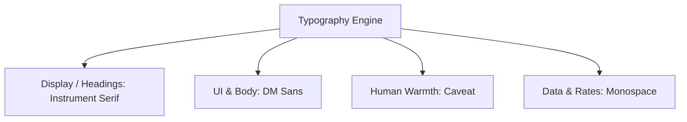

# Community Time Bank AI — Comprehensive Design System Specification

> **Document Classification**: Design System & UI/UX Technical Architecture  
> **Aesthetic Direction**: Warm Editorial • Contemporary Neo-Brutalist Print • Civic Reciprocity  
> **Status**: Production Reference  
> **Version**: 2.0  

---

## 1. Design Philosophy & Creative Direction

The **Community Time Bank AI** platform breaks away from generic, sterile SaaS templates (monotone blues, hyper-rounded pills, generic shadows) and adopts a **Warm Editorial & Contemporary Neo-Brutalist Print** aesthetic. 

The visual identity is modeled after an artisanal civic dispatch, academic press publication, and high-trust community journal:

- **Tangible & Tactile**: Sharp square corners (`rounded-none` / `border-radius: 0px`) and defined 1px borders mimic physical print cards, broadsheet papers, and civic certificates.
- **Warmth & Trust**: A soft warm ivory canvas (`#F7F4EC`) replaces harsh stark white screens, establishing an approachable, community-oriented warmth.
- **Editorial Typography**: A deliberate high-contrast typographic pairing between classical literary serif headings (`Instrument Serif`), modern high-legibility body sans (`DM Sans`), and playful handwritten notes (`Caveat`).
- **High-Contrast Neo-Brutalist Accents**: Vibrant canary yellow highlighter fills (`#FFD21C`) and crisp hard offset drop shadows (`shadow-[8px_8px_0px_0px_#111111]`) draw instant focus to critical civic actions and algorithmic match scores.
- **Solidarity Symbolism**: Deep forest green (`#123D32`) anchors civic trust, mutual aid, and sustainable community contributions.

---

## 2. Color System & Design Tokens

### 2.1 Primary Canvas & Surface Tokens (Light Mode)

| Token Name | Hex Code | Tailwind Class | Semantic Usage |
| :--- | :--- | :--- | :--- |
| **Canvas Primary** | `#F7F4EC` | `bg-[#F7F4EC]` / `bg-ivory` | Main application backdrop, body surface |
| **Surface Card** | `#FAF8F3` | `bg-[#FAF8F3]` / `bg-ivory-50` | Content cards, metric boxes, modal containers |
| **Surface Alternate** | `#FDFBF7` | `bg-[#FDFBF7]` | Form input fields, search boxes, nested panels |
| **Surface Hover** | `#EFECE3` | `hover:bg-[#EFECE3]` | Secondary button hover, active row highlighting |
| **Border Neutral** | `#E5E0D8` | `border-[#E5E0D8]` / `border-border-editorial` | Standard 1px divider, card outlines, table borders |
| **Border Strong** | `#D8D1C2` | `border-[#D8D1C2]` / `border-ivory-300` | Secondary buttons, prominent separators |

### 2.2 Dark Mode Surface Tokens

| Token Name | Hex Code | Tailwind Class | Semantic Usage |
| :--- | :--- | :--- | :--- |
| **Dark Canvas** | `#141414` / `#111111` | `dark:bg-[#141414]` | Night-time main viewport background |
| **Dark Card** | `#1C1C1C` / `#151515` | `dark:bg-[#1C1C1C]` | Elevated dark cards, panels, modal windows |
| **Dark Surface Hover** | `#262626` | `dark:hover:bg-[#262626]` | Hover state for dark rows and cards |
| **Dark Border** | `#262626` / `#2A2A2A` | `dark:border-[#262626]` | Dark mode structural dividers and card borders |
| **Dark Border Active**| `#444444` / `#555555` | `dark:border-[#444444]` | Hover border highlights in dark mode |

### 2.3 Typography Colors

| Semantic Role | Light Mode Hex | Dark Mode Hex | Usage |
| :--- | :--- | :--- | :--- |
| **Primary Text** | `#111111` (Charcoal-900) | `#FFFFFF` / `#F7F4EC` | Headlines, prominent titles, hero text |
| **Secondary Text** | `#4A4A4A` (Charcoal-600) | `#B0B0B0` (Charcoal-300) | Body paragraphs, descriptive explanations |
| **Muted / Caption** | `#6B6B6B` (Charcoal-500) | `#8E8E8E` (Charcoal-400) | Timestamps, metadata labels, unit signs |
| **Mono Labels** | `#111111` / `#4A4A4A` | `#FFD21C` / `#E5E0D8` | System codes, ratio indicators, category indices |

### 2.4 Brand & Semantic Accent Tokens

| Palette | Hex Code | Tailwind Alias | Psychological / Functional Meaning |
| :--- | :--- | :--- | :--- |
| **Editorial Yellow** | `#FFD21C` | `yellow.editorial` | Core action driver, active nav tab, 100% match badge, highlighter tag |
| **Yellow Hover** | `#E8BD14` | `yellow.hover` | Interactive state for primary yellow buttons |
| **Yellow Tint** | `#FFF6CE` | `yellow.light` | Soft background banners, alert callouts |
| **Forest Green** | `#123D32` | `forest.DEFAULT` | Mutual aid solidarity fund, verified checkmarks, credit additions |
| **Forest Dark** | `#0A241E` | `forest.dark` | Forest hover states and high-contrast badges |
| **Crimson / Danger** | `#DC2626` | `text-red-600` | Account cancellations, errors, dispute flags |
| **Gold / Star Rating**| `#FFD21C` | `fill-[#FFD21C]` | Community trust rating stars, verified review badges |

### 2.5 Complexity Multiplier Badges

| Multiplier Tier | Value | Visual Badge Styling | Intended Service Domain |
| :--- | :--- | :--- | :--- |
| **Standard** | `1.0×` | Slate/Charcoal badge (`bg-slate-100 text-slate-800 border-slate-300`) | Peer tutoring, conversational practice, errands |
| **Intermediate** | `1.25×` | Indigo/Blue badge (`bg-indigo-50 text-indigo-800 border-indigo-200`) | Diagnostics, certified skills, specialized tools |
| **Advanced Cap** | `1.5×` | Purple/Violet badge (`bg-purple-100 text-purple-900 border-purple-300`) | Component repair, hazardous tools, accredited translation |

---

## 3. Typography System

The typography system communicates authority, warmth, and algorithmic clarity.



### 3.1 Typeface Families

1. **Heading Display**: `Instrument Serif`, Georgia, serif  
   - *Characteristics*: High contrast, classical proportions, elegant italics, distinct editorial personality.
   - *Weights*: 400 Regular, 400 Italic.
   - *Application*: `h1`, `h2`, `h3`, hero banners, brand logo ("TimeBank *AI*"), large credit numerals.
2. **Body & User Interface**: `DM Sans`, system-ui, -apple-system, sans-serif  
   - *Characteristics*: Modern geometric grotesk, neutral, exceptional legibility at small sizes (11px–14px).
   - *Weights*: 400 Regular, 500 Medium, 600 Semi-Bold, 700 Bold.
   - *Application*: Navigation links, descriptions, form labels, buttons, tables.
3. **Handwritten Community Accents**: `Caveat`, cursive  
   - *Characteristics*: Natural pen strokes, human touch, friendly community authenticity.
   - *Weights*: 600 Semi-Bold, 700 Bold.
   - *Application*: Community mottos ("Skills • Communities • People"), stamp callouts, handwritten notes.
4. **Data & Metrics**: System Monospace (`ui-monospace`, `SFMono-Regular`, `Consolas`, monospace)  
   - *Application*: Multiplier formulas (`2.0h × 1.5×`), voucher codes (`TB-RED-9842`), match scores (`94%`), numeric tags (`[01]`).

### 3.2 Typographic Hierarchy Scale

| Level | Size | Weight | Line Height | Tracking | Font Family | Example Usage |
| :--- | :--- | :--- | :--- | :--- | :--- | :--- |
| **Display 1** | `72px` (`5xl–7xl`) | 700 Bold | `1.05` | `-0.02em` | `Instrument Serif` | Landing page hero main statement |
| **Heading 1** | `36px–40px` (`3xl–4xl`)| 700 Bold | `1.15` | `-0.01em` | `Instrument Serif` | Main dashboard & page titles |
| **Heading 2** | `24px–28px` (`2xl`) | 700 Bold | `1.2` | `-0.01em` | `Instrument Serif` | Section headers, modal titles |
| **Heading 3** | `18px–20px` (`lg–xl`) | 600 SemiBold| `1.3` | `normal` | `Instrument Serif` | Card titles, provider names |
| **Body Large** | `16px` (`base`) | 400 Regular | `1.5` | `normal` | `DM Sans` | Lead paragraphs, hero subtext |
| **Body Regular**| `14px` (`sm`) | 400 / 500 | `1.4` | `normal` | `DM Sans` | Primary text, descriptions, table rows |
| **Body Small** | `12px` (`xs`) | 500 Medium | `1.4` | `normal` | `DM Sans` | Form helpers, metadata, buttons |
| **Micro Mono** | `10px–11px` | 700 Bold | `1.2` | `0.15em` | Monospace | Category indexes `[01]`, uppercase tags |

---

## 4. Layout, Spacing & Elevation Architecture

### 4.1 Zero-Radius Rule (`rounded-none`)
Every card, button, modal window, badge, and input field in TimeBank AI uses **strict 0px border-radius**. This reinforces the tactile broadsheet/editorial design language and prevents the "generic round-cornered SaaS" appearance.

### 4.2 Elevation & Neo-Brutalist Drop Shadows
Rather than subtle blurred drop shadows, the system uses sharp, tactile offsets:
- **Card Default**: Flat 1px border (`border border-[#E5E0D8] dark:border-[#262626]`).
- **Interactive Action Shadow**: `shadow-[2px_2px_0px_0px_#111111]` with micro-hover translation (`hover:-translate-y-0.5 active:translate-y-0`).
- **Modal & High-Priority Window**: Heavy 8px offset shadow:  
  `shadow-[8px_8px_0px_0px_#111111] dark:shadow-[8px_8px_0px_0px_#000000]`  
  with 2px solid border (`border-2 border-black dark:border-[#333333]`).

### 4.3 Structural Shell & Grid Layout
- **Left Navigation Rail**: Fixed width 224px (`w-56`), full viewport height (`min-h-screen`), permanent 1px right border (`border-r border-[#E5E0D8] dark:border-[#262626]`).
- **Top Utility Header**: Height 56px (`h-14`), sticky positioning (`sticky top-0 z-30`), housing global search, wallet pill, notification center, and dark/light mode toggle.
- **Main Container**: Max-width `max-w-7xl` (1280px), centered with responsive padding (`px-4 sm:px-6 lg:px-8`).
- **Grid Patterns**:
  - **Hero Section**: 12-column responsive layout (6-col text / 6-col editorial collage).
  - **Metric Row**: 4-column responsive grid (`grid-cols-2 lg:grid-cols-4 gap-4`).
  - **Directory Catalog**: 3-column responsive card grid (`grid-cols-1 md:grid-cols-2 lg:grid-cols-3 gap-6`).

---

## 5. Component Library & UI Patterns

### 5.1 Button Variants

```html
<!-- Primary Button (Crisp Charcoal/White) -->
<button class="btn-primary px-5 py-2.5 bg-[#111111] hover:bg-[#2A2A2A] text-white text-xs font-medium border border-[#111111] rounded-none">
  Primary Action
</button>

<!-- Secondary Button (Warm Ivory Bordered) -->
<button class="btn-secondary px-5 py-2.5 bg-[#F7F4EC] hover:bg-[#EFECE3] text-[#111111] text-xs font-medium border border-[#D8D1C2] rounded-none">
  Secondary Action
</button>

<!-- Yellow Editorial Action Button (Brutalist Offset) -->
<button class="btn-yellow px-5 py-2.5 bg-[#FFD21C] hover:bg-[#E8BD14] text-[#111111] font-bold text-xs uppercase tracking-wider border border-black shadow-[2px_2px_0px_0px_#111111] rounded-none">
  Donate Credits
</button>

<!-- Forest Solidarity Button -->
<button class="btn-forest px-5 py-2.5 bg-[#123D32] hover:bg-[#0E3027] text-white text-xs font-medium border border-[#123D32] rounded-none">
  Confirm Allocation
</button>
```

### 5.2 Editorial Cards
Cards feature `#FAF8F3` (light) / `#1C1C1C` (dark) backgrounds with crisp 1px borders.

- **`.editorial-card`**: Base card styling with clean padding.
- **`.light-card-hover`**: Smooth border transition on hover from `#E5E0D8` to `#111111` (dark: `#555555`).
- **`.editorial-highlight`**: Inline highlighter tag simulating canary yellow marker pen (`bg-[#FFD21C] text-[#111111] px-1`).

### 5.3 Form Controls & Input Styling
- Inputs use sharp 0px corners, `#FDFBF7` light-ivory background, and dark `#111111` active focus rings.
- Dropdowns, date-pickers, and time-slot selectors feature high-contrast active states (Yellow active pill `#FFD21C` with black text).

### 5.4 Badges & Status Chips
- **Match Score Badge**: `px-3 py-1 bg-[#FFD21C] text-black border border-black text-xs font-mono font-extrabold uppercase`.
- **Verified Skill Badge**: Background `#F7F4EC`, border `#E5E0D8`, accompanied by an embedded proficiency chip (`EXPERT`, `INTERMEDIATE`).
- **Live Formula Banner**: Displayed inside booking modals:
  $$\text{Duration (2.0 hrs)} \times \text{Multiplier (1.5×)} = \mathbf{3.0\text{ Credits}}$$

### 5.5 Modals & Dialog Windows
- Fixed centered layout with darkened backdrop: `bg-black/70 backdrop-blur-xs`.
- Modal body: `bg-[#FAF8F3] dark:bg-[#151515] border-2 border-black dark:border-[#333333] shadow-[8px_8px_0px_0px_#111111]`.
- Top-right close button with tactile hover feedback.

---

## 6. Micro-Interactions & State Architecture

1. **Algorithmic 5-Factor Radar / Bar Breakdown**:
   - Visual progress bars evaluating Skill Similarity, Area Proximity, Rating Reputation, Availability Match, and Urgency Responsiveness.
2. **Double-Confirmation Service Sign-off**:
   - Both Provider and Requester independently confirm completion.
   - On final confirmation, a celebratory `canvas-confetti` explosion fires, followed by an immediate credit balance ledger update.
3. **1-Click Monospace Voucher Copy**:
   - Monospace redemption code (`TB-RED-XXXX-YYYY`) transforms visually on click with an instant checkmark icon and 2.5s tooltip notice.
4. **Editorial Skeleton Shimmer**:
   - Replaces generic spinners with `.skeleton-shimmer` pulsing from ivory tone `#E7E2D6` to dark `#262626`.

---

## 7. Presentation Deck Guide (10 Ready-to-Use PPT Slides)

Use the following slide outlines directly to build your PowerPoint / Keynote presentation.

---

### Slide 1: Title & Theme
- **Slide Title**: TimeBank AI — Design System & Visual Architecture
- **Subtitle**: Warm Editorial & Contemporary Neo-Brutalist Aesthetics for Civic Skill Sharing
- **Visual Suggestion**: Split layout with the official TimeBank AI emblem (⌛) on the left, warm ivory background `#F7F4EC`, and bold title in `Instrument Serif`.
- **Bullet Points**:
  - Purpose: Replacing commercial currency with audited time reciprocity.
  - Design Thesis: High-trust broadsheet publication meets modern AI interface.
  - Tech Foundation: React, TypeScript, Tailwind CSS, Lucide Icons, Canvas Confetti.
- **Presenter Notes**:  
  *"Good morning. Today I'm presenting the Design System behind TimeBank AI. Unlike common SaaS products that rely on generic blue buttons and curved cards, TimeBank AI uses a warm editorial, neo-brutalist print aesthetic designed to convey high community trust, dignity, and civic transparency."*

---

### Slide 2: Design Philosophy & Creative Rationale
- **Slide Title**: Core Design Pillars: Why Editorial & Neo-Brutalist?
- **Visual Suggestion**: 3 distinct cards highlighting the 3 core pillars.
- **Bullet Points**:
  - **Tactile Broadside Feel**: Zero border-radius (`rounded-none`) creates the grounded feel of physical civic certificates and broadsheet newspapers.
  - **Parchment Warmth**: Warm Ivory (`#F7F4EC`) eliminates the sterile, cold feeling of stark white monitors.
  - **Canary Highlighter Accents**: `#FFD21C` acts as a physical highlighter marker, guiding attention to key algorithmic metrics.
  - **Solidarity Anchor**: Deep Forest Green (`#123D32`) represents mutual aid, sustainable growth, and community welfare.
- **Presenter Notes**:  
  *"Time banking is inherently human and local. By using an editorial newspaper design language, the interface feels like an established community institution rather than a speculative financial app."*

---

### Slide 3: Color Palette & Semantic Tokens
- **Slide Title**: Color Palette & Design Tokens
- **Visual Suggestion**: Color swatches showing Hex values, names, and contrast badges.
- **Table / Swatches**:
  - **Ivory Canvas**: `#F7F4EC` (Primary Light Canvas)
  - **Card Surface**: `#FAF8F3` (Crisp Container Background)
  - **Charcoal Typography**: `#111111` (Deep, high-contrast readable print)
  - **Editorial Yellow**: `#FFD21C` (Highlighter, Match Scores, Primary Callouts)
  - **Forest Green**: `#123D32` (Solidarity Pool, Positive Verification)
  - **Border Gray**: `#E5E0D8` (Clean 1px architectural lines)
- **Presenter Notes**:  
  *"Every color has an audited semantic role. Charcoal text on warm ivory achieves a contrast ratio well above 12:1, easily surpassing WCAG AAA standards for readability."*

---

### Slide 4: Typographic Pairing & Hierarchy
- **Slide Title**: Typographic Harmony: Literary Serif & Precision Sans
- **Visual Suggestion**: Side-by-side sample specimen cards of the three Google Fonts.
- **Bullet Points**:
  - **Display / Heading**: `Instrument Serif` — Literary elegance, broadsheet gravitas, authoritative headings.
  - **UI / Body**: `DM Sans` — Crisp modern geometric sans, optimized for dense dashboard readability.
  - **Human Touch**: `Caveat` — Handwritten cursive script for community stamps, mottos, and signatures.
  - **Data Precision**: Monospace — Standardized rates (`1.5×`), voucher serials, and timestamps.
- **Presenter Notes**:  
  *"This trio of typefaces tells a story: Instrument Serif brings dignity and heritage, DM Sans brings digital clarity and accessibility, while Caveat reminds users of real human hands and neighborly goodwill."*

---

### Slide 5: Layout System & Structural Shell
- **Slide Title**: Layout Architecture & Grid Mechanics
- **Visual Suggestion**: Wireframe diagram illustrating the Left Sidebar, Top Bar, and 12-Column Responsive Grid.
- **Bullet Points**:
  - **Dual-Pane Shell**: Fixed 56-width vertical navigation sidebar paired with sticky 56px top action header.
  - **12-Column Fluid Grid**: Seamless responsiveness from mobile single-column to wide-desktop 4-column metric layouts.
  - **Hard Offset Elevation**: Neo-brutalist shadows (`8px 8px 0px #111111` and `2px 2px 0px #111111`) provide tactile depth without blurry elevation.
  - **Zero Border-Radius**: Strict consistency across every button, card, input, and modal dialog.
- **Presenter Notes**:  
  *"Our layout uses clean, straight architectural lines. Notice how the absence of border radius makes content feel dense, structured, and deliberate."*

---

### Slide 6: Core Component Library
- **Slide Title**: Component System: Buttons, Cards, Inputs & Modals
- **Visual Suggestion**: Grid showing rendered buttons, interactive cards, input states, and the modal pattern.
- **Bullet Points**:
  - **Buttons**: Four tailored variants — Primary Charcoal, Secondary Ivory, Yellow Action, and Forest Solidarity.
  - **Cards**: Bordered editorial containers with hover elevation and crisp dividers.
  - **Modals**: Heavy 8px offset neo-brutalist shadows with darkened backdrop blur (`bg-black/70`).
  - **Badges**: High-visibility chips for algorithmic fit percentages and verified skills.
- **Presenter Notes**:  
  *"Every component is fully reusable and shared across all 12 major portal pages. The consistency ensures users never feel lost, whether they are booking a peer or inspecting their wallet ledger."*

---

### Slide 7: Specialized UI: Fair Multiplier System
- **Slide Title**: Transparent UX: Fair Credit Multipliers & Live Formula Box
- **Visual Suggestion**: Screenshot/mockup of the Booking Modal showing the live calculation box.
- **Bullet Points**:
  - **Audited Tiers**: Standard (1.0×), Intermediate (1.25×), and Advanced Cap (1.5×).
  - **Color-Coded Badges**: Purple for Advanced, Blue for Intermediate, Slate for Standard.
  - **Live Dynamic Preview**: `Hours × Multiplier = Total Credits Required` updates instantly on duration adjustment.
  - **Mutual Consent Banner**: Guarantees that rates are locked and immutable once accepted by both parties.
- **Presenter Notes**:  
  *"To prevent exploitation while honoring complex skills, we engineered a Fair Credit Multiplier System. The UI makes calculations 100% transparent before a booking is requested."*

---

### Slide 8: Specialized UI: Solidarity Pool & Perk Redemption
- **Slide Title**: Mutual Aid & Rewards: Community Pool & Perks Catalog
- **Visual Suggestion**: Visual showcase of the Community Pool metrics card and the Perk voucher card.
- **Bullet Points**:
  - **Community Credit Pool (`/community-pool`)**: Emerald and canary visual accents with real-time audit feed and quick donation chips (0.5h, 1.0h, 2.0h, 5.0h).
  - **Perks & Vouchers (`/redeem`)**: Catalog of campus and local partner vouchers with 1-click copyable coupon codes.
  - **Non-Fiat Guarantee**: Prominent notices reminding users that credits represent community hours and cannot be converted to cash.
- **Presenter Notes**:  
  *"The Community Pool enables surplus hours to be gifted into a reserve fund for seniors and students. The UI balances generosity with strict transparent accounting."*

---

### Slide 9: Dark Mode & Theme Transition Architecture
- **Slide Title**: Seamless Day & Night: Class-Based Dark Theme
- **Visual Suggestion**: Split image comparing the Dashboard in Warm Light Mode (`#F7F4EC`) versus Deep Charcoal Dark Mode (`#141414`).
- **Bullet Points**:
  - **Persistent Theme Context**: Single-click toggle in Top Header with automatic localStorage caching.
  - **Carefully Balanced Charcoal**: Uses `#141414` canvas and `#1C1C1C` cards instead of pitch black, avoiding eye fatigue.
  - **Preserved Highlight Contrast**: Canary yellow (`#FFD21C`) shines with ultra-high contrast against dark surfaces.
  - **Muted Structural Borders**: Dark borders (`#262626`) maintain card definition without visual noise.
- **Presenter Notes**:  
  *"Dark mode was not an afterthought. It was architected from day one using Tailwind CSS class hierarchies, ensuring every card, button, and text element transitions smoothly in 150ms."*

---

### Slide 10: Accessibility, Performance & Engineering Summary
- **Slide Title**: Engineering Rigor & Accessibility Compliance
- **Visual Suggestion**: Checklist graphic highlighting WCAG 2.1 AA benchmarks and performance metrics.
- **Bullet Points**:
  - **WCAG 2.1 AA Compliance**: High-contrast ratios, visible focus outlines, screen-reader semantic tags.
  - **No Color-Alone Reliance**: Every status communicates via text, icons, and numeric tags simultaneously.
  - **Micro-Animations**: Shimmer skeletons during data fetch; celebratory confetti upon verified double-confirmation.
  - **Production-Ready Bundle**: Vite + Tailwind CSS zero-runtime footprint for fast mobile load times.
- **Presenter Notes**:  
  *"In conclusion, the TimeBank AI design system combines aesthetic distinction with engineering discipline. It honors the dignity of community labor and delivers an intuitive, accessible experience for every member."*

---

## 8. Summary Token Reference Table

```css
/* Core Design Tokens in CSS format */
:root {
  --color-canvas-light: #F7F4EC;
  --color-canvas-dark: #141414;
  --color-card-light: #FAF8F3;
  --color-card-dark: #1C1C1C;
  --color-editorial-yellow: #FFD21C;
  --color-forest-green: #123D32;
  --color-charcoal-primary: #111111;
  --color-border-editorial: #E5E0D8;
  --color-border-dark: #262626;
  
  --font-serif: 'Instrument Serif', Georgia, serif;
  --font-sans: 'DM Sans', system-ui, sans-serif;
  --font-handwriting: 'Caveat', cursive;
  
  --radius-default: 0px;
  --shadow-brutalist-sm: 2px 2px 0px 0px #111111;
  --shadow-brutalist-lg: 8px 8px 0px 0px #111111;
}
```
